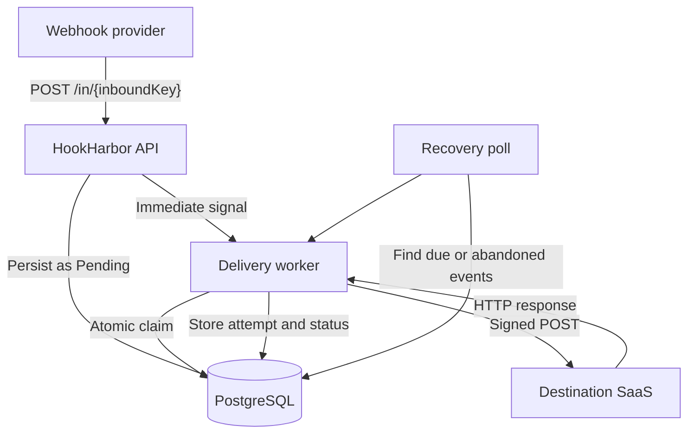
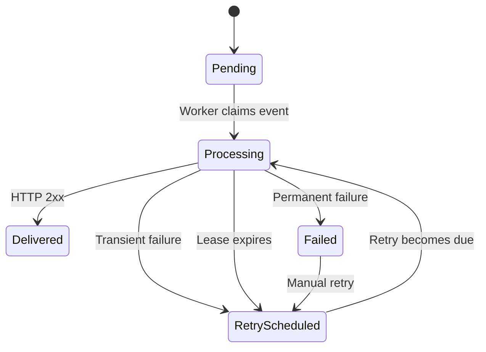

# HookHarbor

HookHarbor is a self-hosted webhook gateway that receives, persists, forwards, retries, and tracks webhook deliveries.

It sits between external providers—such as Stripe, PagarMe, or HubSpot—and your application, adding durability, delivery diagnostics, controlled retries, and operational visibility.

```text
Provider → HookHarbor → Your SaaS
```

## Why HookHarbor?

Sending webhooks directly to an application is simple until something goes wrong:

- The application is temporarily unavailable.
- A deployment causes webhook handlers to fail.
- A destination URL is misconfigured.
- A provider retries an event, creating duplicates.
- Nobody knows which payload was received or what response was returned.
- A failed event needs to be delivered again manually.

HookHarbor accepts and persists the webhook before attempting delivery. The provider can receive a fast acknowledgement while delivery continues independently.

Every attempt is recorded with its destination, timestamps, HTTP status, response body, errors, and outcome.

## Features

- Durable webhook ingestion
- Raw request-body preservation
- Original header preservation
- Asynchronous delivery worker
- Immediate in-memory delivery signaling
- Database polling as a recovery mechanism
- Atomic event claiming for concurrent workers
- Processing leases for abandoned-event recovery
- Automatic retry with exponential-style backoff
- Retry classification for transport errors, timeouts, `408`, `429`, and `5xx`
- Manual retry of failed events
- Paginated event history with status filtering
- Complete event and delivery-attempt diagnostics
- Management API-key authentication
- Inbound webhook rate limiting
- HMAC-SHA256 signatures on outbound deliveries
- Configurable response-body capture limits
- Docker and Docker Compose deployment
- PostgreSQL persistence
- Integration tests using real PostgreSQL Testcontainers
- GitHub Actions continuous integration

## How it works



### Ingestion

HookHarbor:

1. Resolves the endpoint from its cryptographically random inbound key.
2. Reads the request body as raw bytes.
3. Stores its content type and headers.
4. Persists the event as `Pending`.
5. Returns `202 Accepted`.
6. Signals the delivery worker.

The database write happens before signaling. If the in-memory signal cannot be queued or the application restarts, database polling recovers the persisted event.

### Delivery

The worker atomically claims a deliverable event by changing its status to `Processing`.

Only one worker can successfully claim a particular event, even when multiple workers discover the same candidate concurrently.

Each delivery attempt stores:

- Attempt number
- Destination URL used for that attempt
- Start and completion timestamps
- HTTP response status
- Captured response body
- Whether the response body was truncated
- Transport or timeout error
- Success status

The destination URL is stored on the attempt as a historical snapshot. Changing an endpoint does not rewrite previous delivery history.

## Event lifecycle



## Retry policy

HookHarbor automatically retries transient failures:

| Failure | Retried? |
|---|---:|
| Transport error | Yes |
| Destination timeout | Yes |
| HTTP `408` | Yes |
| HTTP `429` | Yes |
| HTTP `5xx` | Yes |
| Other HTTP `4xx` | No |
| HTTP `2xx` | Delivered |

The default retry delays are:

| Failed attempt | Next delay |
|---:|---:|
| 1 | 10 seconds |
| 2 | 1 minute |
| 3 | 5 minutes |
| 4 | 30 minutes |

After five unsuccessful automatic attempts, the event becomes `Failed`.

A failed event can be manually scheduled for one additional delivery attempt through the management API.

## Delivery guarantees

HookHarbor provides **at-least-once delivery**, not exactly-once delivery.

A destination may process a request successfully and fail before HookHarbor receives the response. In that situation, HookHarbor cannot know whether processing occurred and may retry the event.

Destination webhook handlers must therefore be idempotent. A typical approach is to persist the provider event ID or HookHarbor event ID and ignore an event that has already been processed.

## Security

### Management API

All `/api/...` routes require:

```http
X-HookHarbor-Api-Key: your-management-key
```

The key is configured through an environment variable and compared using a timing-safe operation.

The following routes remain public because webhook providers and infrastructure monitoring must reach them:

```text
POST /in/{inboundKey}
GET  /health
```

### Inbound endpoints

Inbound URLs contain a cryptographically random 192-bit key:

```text
/in/030048ba3f673cffccd116b5544c890dc51df6d0c0677cfd
```

Treat the complete inbound URL as a credential. Do not commit it, expose it in public logs, or share it unnecessarily.

Inbound requests are rate-limited and restricted to a maximum body size of 1 MB.

### Provider headers

HookHarbor preserves original provider headers, including signature headers such as:

```http
Stripe-Signature: ...
```

Unsafe transport headers—such as `Host`, `Content-Length`, and `Transfer-Encoding`—are not forwarded.

HookHarbor’s own internal authentication and signature headers are also removed before forwarding original headers.

Provider-specific inbound signature verification is not currently performed by HookHarbor. Applications may continue validating the original provider signature when its timestamp remains valid.

### Outbound signatures

Every delivery includes:

```http
X-HookHarbor-Event-Id: <event-id>
X-HookHarbor-Delivery-Id: <attempt-id>
X-HookHarbor-Timestamp: <unix-timestamp>
X-HookHarbor-Signature: v1=<hmac-sha256>
```

The signature is calculated from:

```text
timestamp + "." + raw request body
```

using the endpoint’s signing secret.

The destination should:

1. Reject timestamps outside an acceptable tolerance.
2. Recompute the HMAC using the raw request bytes.
3. Compare signatures using a timing-safe operation.
4. Apply idempotency using the event ID.

Always deploy HookHarbor behind HTTPS in production. The provided application container listens on HTTP port `8080` and is intended to sit behind a TLS-terminating reverse proxy.

## Quick start with Docker

### Requirements

- Docker
- Docker Compose

### 1. Configure the environment

Copy the example environment file:

```bash
cp .env.example .env
```

On PowerShell:

```powershell
Copy-Item .env.example .env
```

Replace the placeholder secrets in `.env`.

A 32-byte random value can be generated in PowerShell with:

```powershell
[Convert]::ToHexString(
    [Security.Cryptography.RandomNumberGenerator]::GetBytes(32)
).ToLowerInvariant()
```

Generate separate values for the PostgreSQL password and management API key.

### 2. Start HookHarbor

```bash
docker compose up --build -d
```

### 3. Check container health

```bash
docker compose ps
```

### 4. Test HookHarbor

```bash
curl http://localhost:8080/health
```

Expected response:

```text
Healthy
```

### 5. View logs

```bash
docker compose logs -f hookharbor
```

By default:

- HookHarbor is available on `http://localhost:8080`.
- PostgreSQL is available from the host on the configured POSTGRES_PORT (5432 by default).
- Containers communicate with PostgreSQL through `postgres:5432`.
- Database migrations run during single-instance application startup.

Do not enable startup migrations on multiple application replicas. Use a separate migration job for multi-instance deployments.

## Configuration

Docker Compose uses .NET’s environment-variable convention, where `__` represents a configuration-section separator.

| Environment variable | Default | Description |
|---|---:|---|
| `POSTGRES_DB` | `hookharbor` | PostgreSQL database |
| `POSTGRES_USER` | `hookharbor` | PostgreSQL user |
| `POSTGRES_PASSWORD` | — | PostgreSQL password |
| `POSTGRES_PORT` | `5432` | Host-side PostgreSQL port |
| `MANAGEMENT_API_KEY` | — | Credential for `/api/...` routes |
| `HOOKHARBOR_PORT` | `8080` | Host-side API port |
| `INBOUND_RATE_LIMIT` | `120` | Requests allowed per rate-limit window |
| `INBOUND_RATE_WINDOW_SECONDS` | `60` | Rate-limit window duration |
| `MAXIMUM_CAPTURED_RESPONSE_BYTES` | `1048576` | Maximum destination response body retained |
| `Database__MigrateOnStartup` | `true` in Compose | Applies EF Core migrations at startup |

Never commit `.env`.

## API overview

### Public routes

| Method | Route | Description |
|---|---|---|
| `GET` | `/health` | Application health |
| `POST` | `/in/{inboundKey}` | Receive an external webhook |

### Management routes

All management routes require `X-HookHarbor-Api-Key`.

| Method | Route | Description |
|---|---|---|
| `POST` | `/api/endpoints` | Create an endpoint |
| `GET` | `/api/endpoints/{id}` | Get endpoint configuration |
| `PUT` | `/api/endpoints/{id}` | Update endpoint name and destination |
| `GET` | `/api/endpoints/{id}/events` | List endpoint events |
| `GET` | `/api/events/{id}` | Get event details and attempts |
| `POST` | `/api/events/{id}/retry` | Retry a failed event |

### Create an endpoint

```http
POST /api/endpoints
Content-Type: application/json
X-HookHarbor-Api-Key: your-management-key

{
  "name": "Stripe payments",
  "destinationUrl": "https://saas.example.com/webhooks/stripe"
}
```

The response includes:

- Endpoint ID
- Inbound key
- Destination URL
- Outbound signing secret
- Creation timestamp

Configure the provider to send webhooks to:

```text
https://hookharbor.example.com/in/{inboundKey}
```

### List events

```http
GET /api/endpoints/{endpointId}/events?page=1&pageSize=20&status=Failed
X-HookHarbor-Api-Key: your-management-key
```

Supported status values include:

```text
Pending
Processing
RetryScheduled
Delivered
Failed
```

### Inspect an event

```http
GET /api/events/{eventId}
X-HookHarbor-Api-Key: your-management-key
```

The response contains the original body, content type, headers, status, retry timing, processing state, and all delivery attempts.

### Manually retry an event

```http
POST /api/events/{eventId}/retry
X-HookHarbor-Api-Key: your-management-key
```

Only events in `Failed` status can be manually retried. Other states return `409 Conflict`.

## Verifying HookHarbor signatures in .NET

The destination must read the raw body before JSON deserialization.

```csharp
using System.Globalization;
using System.Security.Cryptography;
using System.Text;

static bool VerifyHookHarborSignature(
    byte[] rawBody,
    string signingSecret,
    string timestampHeader,
    string signatureHeader,
    TimeSpan tolerance)
{
    if (!long.TryParse(
            timestampHeader,
            NumberStyles.None,
            CultureInfo.InvariantCulture,
            out var timestamp))
    {
        return false;
    }

    var signedAt =
        DateTimeOffset.FromUnixTimeSeconds(timestamp);

    if (DateTimeOffset.UtcNow - signedAt > tolerance
        || signedAt - DateTimeOffset.UtcNow > tolerance)
    {
        return false;
    }

    var prefix = Encoding.UTF8.GetBytes(
        timestampHeader + ".");

    var signedPayload =
        new byte[prefix.Length + rawBody.Length];

    prefix.CopyTo(signedPayload, 0);
    rawBody.CopyTo(signedPayload, prefix.Length);

    var expectedHash = HMACSHA256.HashData(
        Encoding.UTF8.GetBytes(signingSecret),
        signedPayload);

    const string versionPrefix = "v1=";

    if (!signatureHeader.StartsWith(
            versionPrefix,
            StringComparison.Ordinal))
    {
        return false;
    }

    byte[] suppliedHash;

    try
    {
        suppliedHash = Convert.FromHexString(
            signatureHeader[versionPrefix.Length..]);
    }
    catch (FormatException)
    {
        return false;
    }

    return suppliedHash.Length == expectedHash.Length
        && CryptographicOperations.FixedTimeEquals(
            suppliedHash,
            expectedHash);
}
```

Example tolerance:

```csharp
var valid = VerifyHookHarborSignature(
    rawBody,
    signingSecret,
    Request.Headers["X-HookHarbor-Timestamp"].ToString(),
    Request.Headers["X-HookHarbor-Signature"].ToString(),
    TimeSpan.FromMinutes(5));
```

Signature verification authenticates HookHarbor. Idempotency is still required to prevent the same valid event from being processed more than once.

## Development

### Requirements

- .NET 10 SDK
- Docker
- PostgreSQL, supplied locally through Docker

### Build

```bash
dotnet build HookHarbor.slnx
```

### Test

```bash
dotnet test HookHarbor.slnx
```

The integration tests use Testcontainers to start an isolated PostgreSQL instance and apply the real EF Core migrations.

The suite covers:

- Endpoint creation and updates
- Raw webhook ingestion
- Event persistence
- Delivery success and failure
- Retry classification and scheduling
- Concurrent atomic claims
- Processing-lease recovery
- Immediate delivery signaling
- Pagination and filtering
- Event diagnostics
- Manual retries
- Management authentication
- Rate limiting
- Header forwarding and filtering
- Outbound HMAC signatures
- Response-body truncation

## Architecture decisions

### PostgreSQL is the source of truth

The in-memory signal reduces healthy-path delivery latency, but it is not the durable queue.

Events are always persisted before signaling. Database polling recovers work after dropped signals, full channels, or application restarts.

### Atomic claims prevent concurrent processing

Multiple workers may discover the same candidate event. A conditional database update allows only one worker to transition it to `Processing`.

This prevents ordinary concurrent duplicate delivery while preserving at-least-once recovery semantics.

### Processing leases recover abandoned work

If a worker stops after claiming an event, the event could otherwise remain in `Processing` forever.

HookHarbor treats old processing claims as abandoned and makes them eligible for recovery.

### Attempts preserve historical destinations

Endpoints can be updated, but each attempt stores the exact destination URL used at that time. Diagnostics therefore remain historically accurate.

### Response capture is bounded

Destination response bodies are useful for diagnostics but are not part of delivery success.

HookHarbor stores only the configured maximum number of response bytes and records whether the response was truncated.

### Exact-once delivery is not promised

A network failure can happen after the destination has processed an event but before HookHarbor receives its response.

HookHarbor therefore explicitly provides at-least-once delivery and requires idempotent consumers.

## Current limitations

- One management API key per deployment
- No web dashboard
- No provider-specific inbound signature verification
- No automatic event-retention cleanup
- In-memory rate-limit state
- Startup migrations intended for a single application instance
- PostgreSQL is currently the only supported database
- Horizontal deployment requires additional operational configuration

## Roadmap

Potential post-MVP work includes:

- Web management dashboard
- Endpoint signing-secret rotation
- Provider-specific signature verification
- Configurable retry policies per endpoint
- Event-retention and cleanup policies
- Metrics and OpenTelemetry
- Alerting for repeated delivery failures
- Multi-user authentication and authorization
- Distributed rate limiting
- Dedicated migration jobs
- Kubernetes deployment examples
- Additional delivery destinations and routing rules

## Project status

HookHarbor is currently approaching its first MVP release. The core ingestion, delivery, retry, diagnostics, security, testing, and Docker deployment flows are implemented.